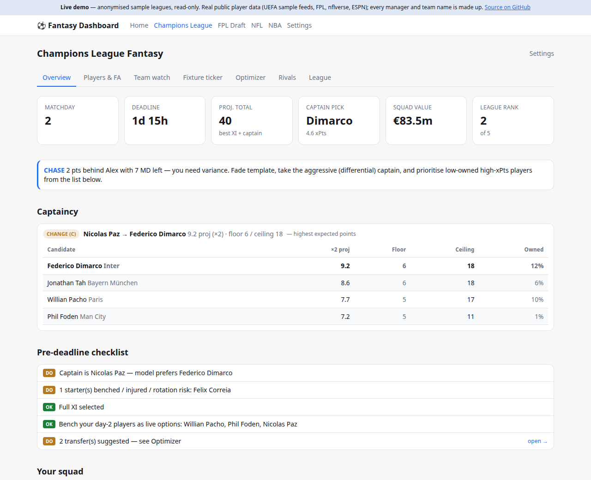
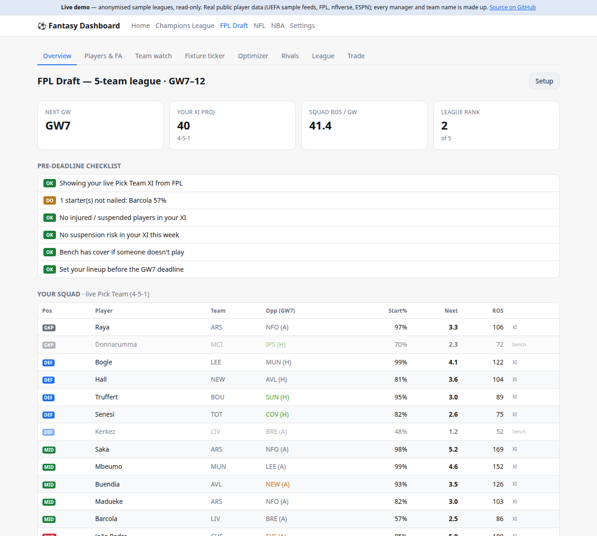
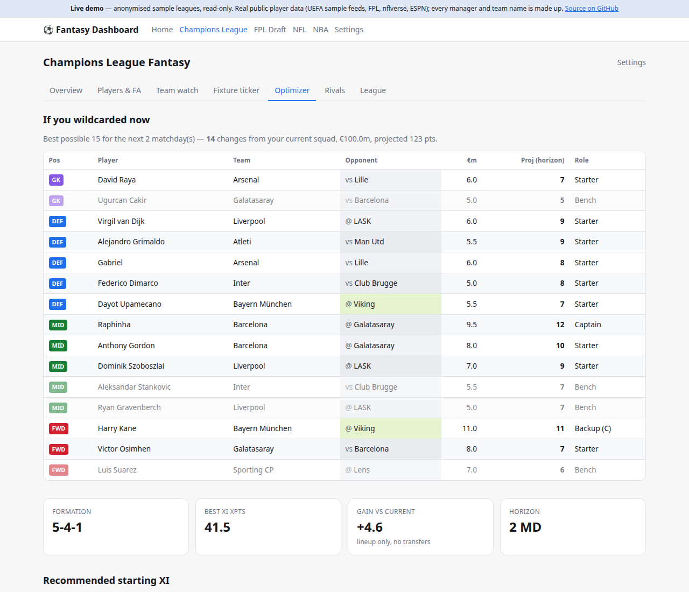
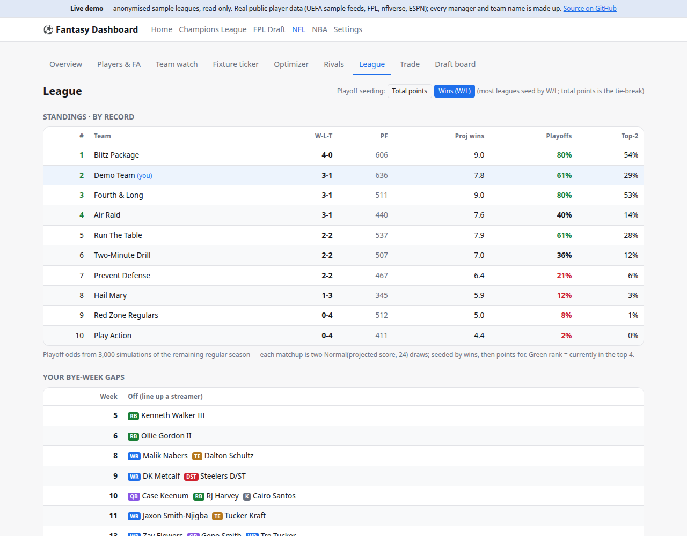
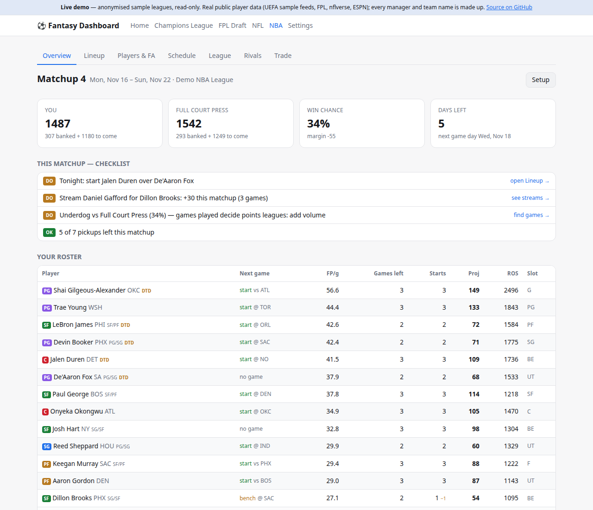
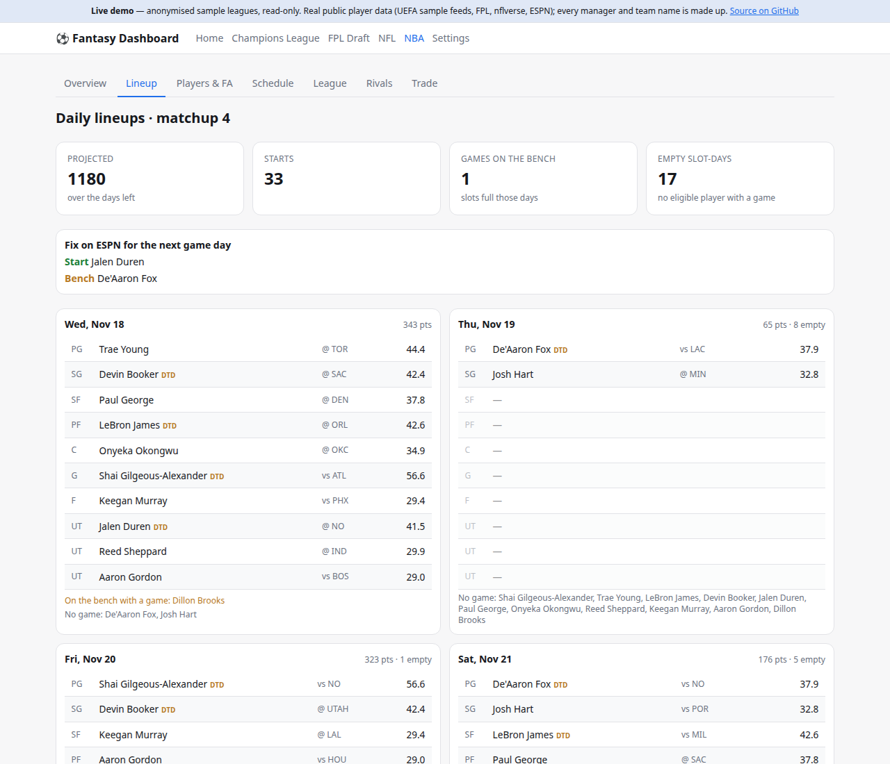
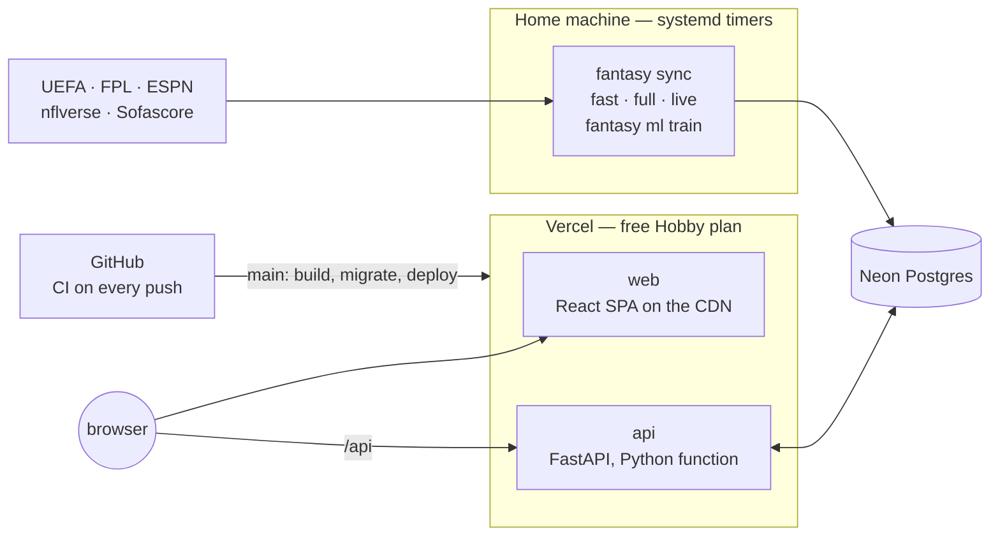

# Fantasy Dashboard

[](https://github.com/lfrocharod/fantasy-dashboard/actions/workflows/ci.yml)

A decision engine for the four fantasy leagues I play — **UEFA Champions
League Fantasy**, **FPL Draft**, **ESPN fantasy football** and **ESPN fantasy
basketball** — in one web app. It pulls each game's data on a schedule,
projects every player's points, and turns that into decisions: who to captain,
start, sign, stream, trade or bench, with the reasoning shown next to the
number.

<p align="center">
  
  
</p>
<p align="center">
  
  
</p>
<p align="center">
  
  
</p>

_Screenshots are from the demo dataset: real public player data, made-up
managers and teams. `docker compose --profile demo up` runs it locally._

## What it does

* **Champions League** — expected points per player from minutes, team-strength
  xG models and recent form; an integer-programming optimizer for the best legal
  XI, transfers over a horizon, and when to play the two chips; a captaincy
  verdict that changes with the mini-league situation (protect a lead, chase a
  gap); a live matchday panel with auto-subs, manual-sub and armband-move advice.
* **FPL Draft** — gameweek projections, rotation planner, waiver claims and
  stash candidates, rival rosters and their likely claims, simulated final
  standings, and a trade lab that values a deal for both sides.
* **NFL (ESPN)** — floor / ceiling lineups chosen by win probability, streaming
  plans, buy-low / sell-high flags from expected-points models, Monte Carlo
  playoff odds, and a draft-night board.
* **NBA (ESPN, head-to-head points)** — the best legal lineup for every day of
  the matchup (an exact slot assignment, not a heuristic), win probability as
  games are played, streaming add/drops that only count the games a pickup
  would actually start, games per matchup and light days for the whole NBA,
  playoff odds, and a trade lab valued on this season's form and the games each
  team has left.
* **A learned FPL model** — gradient-boosted trees on seven seasons of public
  data, judged by a walk-forward backtest and graded live every gameweek next to
  the structural model and FPL's own estimate (below).

## Architecture



* **Collect at home, serve from the cloud.** UEFA's and ESPN's edges block
  datacenter IPs, so the syncs run as systemd timers on a home machine (from a
  clone that tracks `main`). The app runs on Vercel's free tier: the SPA on the
  CDN, FastAPI as a Python function next to the database. No card on file
  anywhere.
  ([ADR 2](docs/adr/0002-collect-at-home-serve-from-the-cloud.md))
* **Python owns the numbers.** Every projection, verdict and checklist comes
  from FastAPI; React renders. The TypeScript client is generated from the
  OpenAPI schema and CI fails if it drifts.
  ([ADR 3](docs/adr/0003-python-owns-the-numbers.md))
* **One site, one repo,** a folder per league on both sides.
  ([ADR 1](docs/adr/0001-one-site-one-repo.md))

| | |
|---|---|
| Frontend | React 19, TypeScript (strict), Vite, Tailwind, TanStack Query, React Router — typed client generated from OpenAPI |
| Backend | FastAPI, Pydantic, SQLAlchemy 2, Alembic, PostgreSQL (psycopg 3) |
| Models | NumPy / pandas / scikit-learn, PuLP (CBC) integer programming, Monte Carlo simulation |
| Delivery | Vercel (Services: Vite on the CDN, FastAPI as a Python function), GitHub Actions CI, Docker (multi-stage, two targets) for the local stack and an image smoke test, systemd timers |
| Quality | pytest against real Postgres, vitest + Testing Library, ruff, mypy, ESLint; every dependency and action pinned |

## The FPL model

Built to answer one question honestly: does a learned model beat the simple
things a manager would otherwise use?

* **Data** — every Premier League player-fixture, 2019-20 to 2025-26 (public
  [FPL history](https://github.com/vaastav/Fantasy-Premier-League)); 178k
  player-gameweeks.
* **Features** — strictly pre-deadline: rolling per-fixture rates (points,
  minutes, ICT, xG involvement, defensive contributions), season-to-date and
  last-season output, team attack/defence from results so far, fixture count
  and venue, price, ownership and net transfers. A test rewrites a future
  result and asserts no earlier feature moves.
* **Evaluation** — walk-forward over four seasons: retrained every four
  gameweeks on everything before them, scored on the players a manager actually
  weighs up.

| 41,653 player-gameweeks, 2022-23 → 2025-26 | MAE | rank corr. | top-20 picks (pts) |
|---|---|---|---|
| **Gradient-boosted trees** | **1.80** | **0.53** | **4.93** |
| Season-to-date rate | 1.93 | 0.41 | 4.65 |
| Recent form (last 4) | 2.00 | 0.40 | 4.32 |
| FPL's own xP (pre-deadline) | 2.07 | 0.40 | 4.33 |

_Regulars only, on the gameweeks where FPL's figure exists so every row is
scored on the same players; rank correlation is within each gameweek; top-20 is
the mean actual score of each method's 20 highest picks._

One finding worth the detour: the dataset's same-week FPL xP is snapshotted
*after* the games — it weights that week's own points more than any earlier
week — so benchmarking against it (or feeding it to the model) leaks the answer.
The [full report](docs/ml/fpl-backtest.md) has the regression, per-season
tables, calibration and feature importances. In production the model predicts
every gameweek; predictions are stored and graded after the games, and the FPL
overview shows its error next to the structural model's and FPL's.

## Running it

```bash
docker compose --profile demo up --build      # http://localhost:8000, demo data
```

Or natively (Python 3.13 + [uv](https://docs.astral.sh/uv/), Node 22):

```bash
cd backend
uv sync --extra jobs --extra ml
export DATABASE_URL=postgresql://localhost/fantasy
uv run fantasy db upgrade
uv run fantasy demo seed                      # demo data — replaces what's in that database
uv run fantasy serve --reload                 # API on :8000

cd frontend && npm ci && npm run dev          # SPA on :5173, proxies /api
```

Tests: `TEST_DATABASE_URL=postgresql://… uv run pytest` and `npm test`.

## Deploying and keeping it fresh

Merging to `main` deploys: Vercel builds both services, and the production
build migrates the database before the new version takes traffic. The data side
needs nothing run by hand: timers sync every league every 30 minutes, fully
once a day, every 5 minutes during Champions League matches, and retrain the
model weekly; failures push to a phone. All of it runs on free tiers.
[docs/operations.md](docs/operations.md) is the runbook (deploys, the home
runner, secrets, cost); [docs/data-sources.md](docs/data-sources.md) lists
every source. Changes go through pull requests with Conventional Commit
titles and tagged releases — see [CONTRIBUTING.md](CONTRIBUTING.md) and the
[changelog](CHANGELOG.md).

```
backend/    the fantasy package: api/, leagues/{ucl,fpl,nfl,nba}/, ml/, migrations/, cli.py
frontend/   the SPA: features/{ucl,fpl,nfl,nba,home,settings}/, shared/, generated api/
infra/      home/ (the systemd runner: install.sh, fantasy-run, timers)
vercel.json the two Vercel services and their routing
docs/       operations, ADRs, the model report, data sources
```
